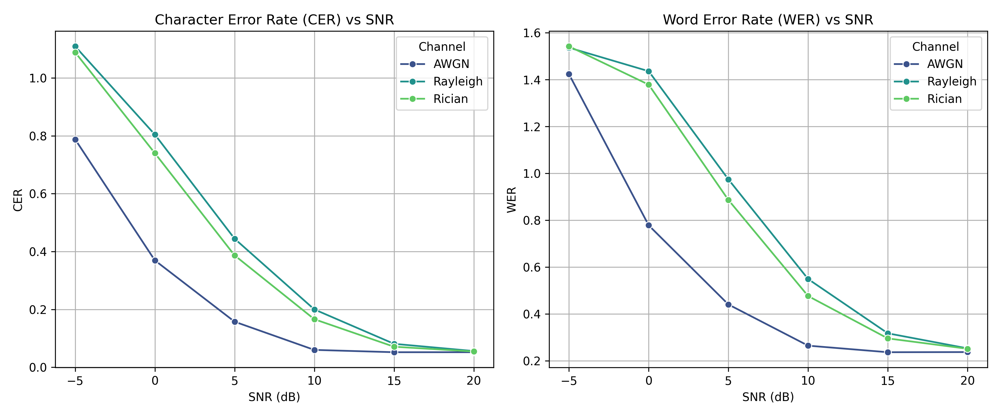
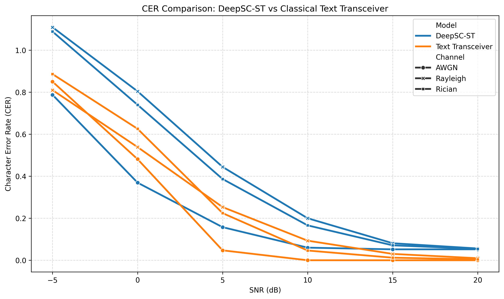
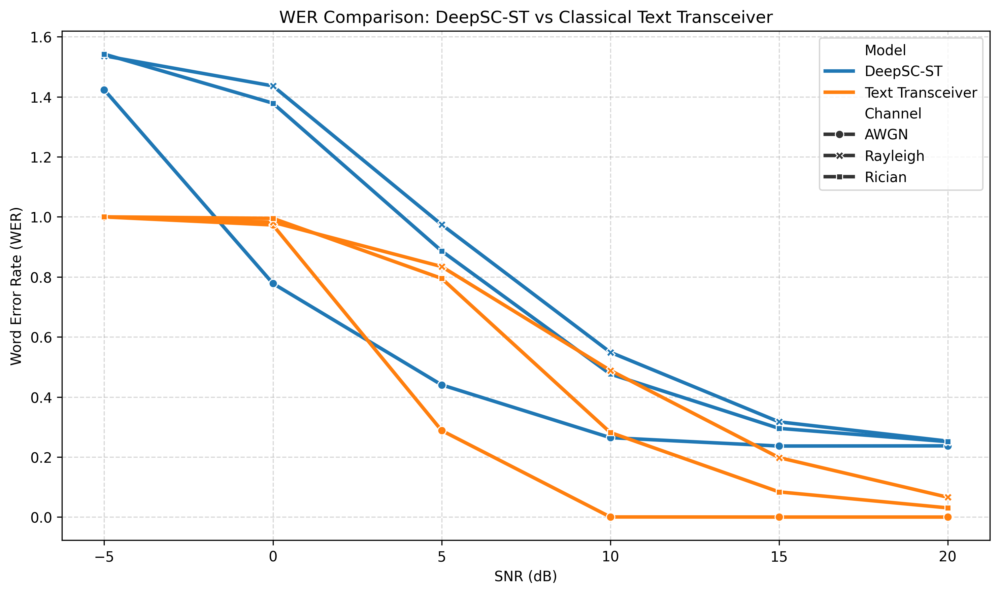

# DeepSC-ST: Deep Semantic Communication for Speech Transmission

A PyTorch implementation of an end-to-end **semantic communication system** for robust speech transmission over noisy wireless channels. Instead of the classical "compress → channel-code → modulate" pipeline, DeepSC-ST is trained jointly, end-to-end, to map raw speech directly to text meaning while surviving realistic channel impairments (AWGN, Rayleigh, and Rician fading) — and it is benchmarked here against a classical bit-level text transceiver to show where semantic communication actually pays off.

> 📓 Full training notebook: [`deep-semantic-communication.ipynb`](./deep-semantic-communication.ipynb)
> 🎧 Sample audio: [`Audio Sample/`](./Audio%20Sample)
> 📊 Result plots & tables: [`Results/`](./Results)
> 📦 Pretrained weights: see the [Releases](../../releases) page of this repo

---

## Table of Contents

- [Overview](#overview)
- [How It Works](#how-it-works)
- [Model Architecture](#model-architecture)
- [Dataset](#dataset)
- [Training](#training)
- [Repository Structure](#repository-structure)
- [Getting Started](#getting-started)
- [Evaluation Results](#evaluation-results)
- [Key Takeaways](#key-takeaways)
- [Baseline: Classical Text Transceiver](#baseline-classical-text-transceiver)
- [References](#references)
- [License](#license)

---

## Overview

Traditional wireless communication systems (source coding → channel coding → modulation) are optimized to reconstruct **bits** exactly, regardless of whether those bits carry any real "meaning." Under poor channel conditions this leads to bit errors that can completely destroy a transmitted message, even if most of the *semantic content* could have survived.

**DeepSC-ST** takes a different approach, inspired by the DeepSC family of semantic communication models:

1. A speech utterance is converted into a log-power spectrogram.
2. A **semantic encoder** (CNN + deep bidirectional GRU stack) extracts a meaning-preserving representation and predicts character probabilities directly from speech (speech-to-text, trained with CTC loss — no separate ASR + text-transmission stages).
3. A **channel encoder** compresses this representation into complex symbols suited for transmission.
4. A **physical channel layer** simulates realistic wireless propagation (AWGN / Rayleigh / Rician fading at a chosen SNR).
5. A **channel decoder** reconstructs the semantic representation from the noisy received symbols.
6. **CTC greedy decoding** converts the recovered class probabilities back into readable text.

The whole pipeline — from raw audio to transmitted text — is trained **jointly and end-to-end**, so the network learns to encode speech in a way that is inherently robust to the channel it is trained on, rather than relying on a separate, rigid error-correction layer.

---

## How It Works

```
 Speech (.wav)
      │
      ▼
 Log-power Spectrogram (161 freq bins)
      │
      ▼
 ┌─────────────────────────────┐
 │      Semantic Encoder        │
 │  2× Conv2D+BN (time/freq)    │
 │  7× Bi-GRU + BatchNorm       │
 │  Linear → Softmax (29 cls)   │
 └─────────────────────────────┘
      │  character probabilities
      ▼
 ┌─────────────────────────────┐
 │      Channel Encoder         │
 │  Dense(40) → Dense(40)       │
 │  Power normalization         │
 └─────────────────────────────┘
      │  complex I/Q symbols
      ▼
 ┌─────────────────────────────┐
 │   Physical Channel Layer     │
 │  AWGN / Rayleigh / Rician    │
 │  (perfect-CSI equalization)  │
 └─────────────────────────────┘
      │  noisy received symbols
      ▼
 ┌─────────────────────────────┐
 │      Channel Decoder         │
 │  Dense(40)→Dense(40)→Dense(29)│
 └─────────────────────────────┘
      │  recovered probabilities
      ▼
 CTC Greedy Decoder → Transcribed Text
```

The model is trained with a single **CTC (Connectionist Temporal Classification) loss** applied directly on the channel-decoder output — the network simultaneously learns to "hear," compress, transmit, and denoise, all in one differentiable pipeline.

---

## Model Architecture

| Component | Details |
|---|---|
| Input feature | Log-power spectrogram, 161 frequency bins, 20 ms frames / 10 ms stride, 16 kHz audio |
| Semantic encoder (CNN) | 2× Conv2D + BatchNorm + ReLU6 (kernel `41×11` then `21×11`, stride `2×2` then `2×1`, 32 filters) |
| Semantic encoder (RNN) | 7-layer bidirectional GRU, 800 hidden units/direction, BatchNorm after every layer |
| Semantic output | Linear + Softmax → 29 classes (26 letters + apostrophe + space + CTC blank) |
| Channel encoder | 2 fully-connected layers → 40-dim channel symbol representation, power-normalized |
| Channel model | AWGN, Rayleigh, or Rician (K = 5) fading with perfect channel-state-information (CSI) equalization at the receiver |
| Channel decoder | 3 fully-connected layers, ReLU6 activations, reconstructs 29-class probabilities |
| Decoding | CTC greedy decoding (arg-max → collapse repeats → drop blanks) |
| Loss | `nn.CTCLoss` (blank index = 28), Adam optimizer, `lr = 1e-4` |
| Total parameters | ≈ 85.8 M |

The channel itself is implemented as a differentiable PyTorch layer (`ChannelLayer`), so gradients can flow back through the simulated wireless channel during training — this is what lets the network learn a *channel-aware* semantic representation instead of a generic one.

---

## Dataset

The model is trained and evaluated on the **[LJSpeech-1.1](https://keithito.com/LJ-Speech-Dataset/)** dataset:

- ~13,100 short audio clips of a single English speaker reading passages from public-domain books
- Paired with normalized text transcripts (`metadata.csv`)
- Split 95% / 5% into train / validation sets
- Vocabulary: lowercase `a–z`, apostrophe, and space (28 symbols + 1 CTC blank = 29 classes)

---

## Training

- **Epochs:** 60 (checkpoints saved every 10 epochs)
- **Batch size:** 64
- **Optimizer:** Adam, learning rate `1e-4`
- **Training channel:** Rician fading at 8 dB SNR (chosen so the model learns a robust representation rather than overfitting to a single "easy" channel)
- **Loss:** CTC loss between the channel-decoder output and the ground-truth transcript
- **Hardware:** trained on GPU (Kaggle/Colab), with checkpoints (`saved_weights_*.pth`) uploaded to the repo's [Releases](../../releases) page since they're too large for version control

---

## Repository Structure

```
Deep-Speech-Communication/
├── deep-semantic-communication.ipynb   # Full training/eval notebook (Colab-generated)
├── deepsc_st_demo.py                   # Standalone script version (see deep_semantic_communication.py)
├── Audio Sample/                       # Example .wav files for quick inference demos
├── Results/                            # Evaluation CSVs and result plots
│   ├── evaluation_results.csv
│   ├── DeepSCST_vs_TextTransceiver.csv
│   ├── evaluation_plots.png
│   ├── CER_Comparison.png
│   └── WER_Comparison.png
├── .gitignore
└── README.md
```

---

## Getting Started

### 1. Clone the repo
```bash
git clone https://github.com/Abhiram0703/Deep-Speech-Communication.git
cd Deep-Speech-Communication
```

### 2. Install dependencies
```bash
pip install torch torchaudio numpy pandas matplotlib seaborn tqdm jiwer soundfile
```

### 3. Download the pretrained weights
Download `saved_weights_60.pth` from this repo's **[Releases](../../releases)** page and note its path — you'll need it for inference.

### 4. Get the dataset (for training/evaluation)
Download [LJSpeech-1.1](https://keithito.com/LJ-Speech-Dataset/) and update `LJSPEECH_ROOT` in the script/notebook to point to it.

### 5. Run inference on a single audio file
```python
model = DeepSCST(CFG).to(DEVICE)
state_dict = torch.load("saved_weights_60.pth", map_location=DEVICE)
model.load_state_dict(state_dict)
model.eval()

x = preprocess_wav("path/to/audio.wav").to(DEVICE)
with torch.no_grad():
    probs = model(x, channel="AWGN", snr_db=10)

decoder = GreedyDecoder(VOCAB_CHARS, blank_index=BLANK_INDEX)
print(decoder.decode_tensor(probs))
```

### 6. Reproduce the evaluation
Run the evaluation cells in the notebook (or the equivalent block in the `.py` script) to sweep over `CHANNELS = ['AWGN', 'Rayleigh', 'Rician']` and `SNR_DB_VALUES = [-5, 0, 5, 10, 15, 20]`, computing CER/WER with `jiwer` and saving results to `evaluation_results.csv`.

---

## Evaluation Results

The model was evaluated on the LJSpeech validation split across three channel models (**AWGN**, **Rayleigh**, **Rician**) and six SNR levels (**−5 to 20 dB**), using **Character Error Rate (CER)** and **Word Error Rate (WER)** — computed with `jiwer` — as the metrics.

### DeepSC-ST performance across channels



Both curves show the expected behavior of a well-trained channel-aware model: error rates fall steeply as SNR increases, then flatten out into an error floor around 10–15 dB.

- **AWGN** is consistently the easiest channel — CER drops from ~0.79 at −5 dB to ~0.05 by 10 dB.
- **Rayleigh** and **Rician** fading are harder (no line-of-sight / partial line-of-sight components cause deep fades), but both still converge to a low CER (~0.05–0.08) and WER (~0.25–0.32) by 15–20 dB.
- Because the model was **trained specifically on Rician fading at 8 dB**, it generalizes gracefully to AWGN and Rayleigh at test time — evidence that the learned semantic representation isn't overfit to one channel statistic.

### DeepSC-ST vs. Classical Text Transceiver

To quantify the benefit of semantic communication, DeepSC-ST is compared against a **classical bit-level baseline**: text → 8-bit ASCII → BPSK modulation → channel → BPSK demodulation → text.

**CER comparison:**



**WER comparison:**



**Full results table (CER / WER by model, channel, and SNR):**

| Model | Channel | SNR (dB) | CER | WER |
|---|---|---:|---:|---:|
| DeepSC-ST | AWGN | -5 | 0.7836 | 1.3881 |
| DeepSC-ST | AWGN | 0 | 0.3663 | 0.7753 |
| DeepSC-ST | AWGN | 5 | 0.1545 | 0.4352 |
| DeepSC-ST | AWGN | 10 | 0.0603 | 0.2626 |
| DeepSC-ST | AWGN | 15 | 0.0525 | 0.2390 |
| DeepSC-ST | AWGN | 20 | 0.0520 | 0.2372 |
| DeepSC-ST | Rayleigh | -5 | 1.1039 | 1.5040 |
| DeepSC-ST | Rayleigh | 0 | 0.8007 | 1.4069 |
| DeepSC-ST | Rayleigh | 5 | 0.4355 | 0.9845 |
| DeepSC-ST | Rayleigh | 10 | 0.2031 | 0.5618 |
| DeepSC-ST | Rayleigh | 15 | 0.0807 | 0.3160 |
| DeepSC-ST | Rayleigh | 20 | 0.0563 | 0.2539 |
| DeepSC-ST | Rician | -5 | 1.0844 | 1.5305 |
| DeepSC-ST | Rician | 0 | 0.7366 | 1.3707 |
| DeepSC-ST | Rician | 5 | 0.3827 | 0.8715 |
| DeepSC-ST | Rician | 10 | 0.1683 | 0.4825 |
| DeepSC-ST | Rician | 15 | 0.0722 | 0.2977 |
| DeepSC-ST | Rician | 20 | 0.0544 | 0.2482 |
| Text Transceiver | AWGN | -5 | 0.8508 | 0.9998 |
| Text Transceiver | AWGN | 0 | 0.4838 | 0.9722 |
| Text Transceiver | AWGN | 5 | 0.0464 | 0.2830 |
| Text Transceiver | AWGN | 10 | 0.0000 | 0.0003 |
| Text Transceiver | AWGN | 15 | 0.0000 | 0.0000 |
| Text Transceiver | AWGN | 20 | 0.0000 | 0.0000 |
| Text Transceiver | Rayleigh | -5 | 0.8097 | 1.0011 |
| Text Transceiver | Rayleigh | 0 | 0.5363 | 0.9833 |
| Text Transceiver | Rayleigh | 5 | 0.2477 | 0.8307 |
| Text Transceiver | Rayleigh | 10 | 0.0913 | 0.4831 |
| Text Transceiver | Rayleigh | 15 | 0.0304 | 0.1973 |
| Text Transceiver | Rayleigh | 20 | 0.0100 | 0.0698 |
| Text Transceiver | Rician | -5 | 0.8876 | 0.9999 |
| Text Transceiver | Rician | 0 | 0.6258 | 0.9925 |
| Text Transceiver | Rician | 5 | 0.2265 | 0.7964 |
| Text Transceiver | Rician | 10 | 0.0478 | 0.2851 |
| Text Transceiver | Rician | 15 | 0.0127 | 0.0874 |
| Text Transceiver | Rician | 20 | 0.0045 | 0.0305 |

*(Full raw data: [`evaluation_results.csv`](./Results/evaluation_results.csv), [`DeepSCST_vs_TextTransceiver.csv`](./Results/DeepSCST_vs_TextTransceiver.csv))*

---

## Key Takeaways

**Where DeepSC-ST wins — low-SNR / harsh-channel regimes.**
At **−5 dB to 5 dB**, DeepSC-ST consistently achieves a *lower or comparable* CER than the classical transceiver, and its **WER curve degrades far more gracefully**. For example, at 0 dB on AWGN the classical transceiver's WER is ~0.97 (i.e., almost every word is wrong), while DeepSC-ST's WER is ~0.78. The gap is even more pronounced on Rayleigh and Rician fading in the 0–5 dB range, where the classical bit-level scheme collapses toward WER ≈ 1.0 (complete communication failure) while DeepSC-ST's semantic representation degrades more slowly and stays partially intelligible. This is exactly the scenario semantic communication is designed for: when the channel is bad enough that *some* information will inevitably be lost, DeepSC-ST loses the *least meaningful* bits first, rather than losing bits at random the way classical bit-level transmission does.

**Where the classical transceiver wins — high-SNR regimes.**
Once the channel is clean (**≥10 dB, especially on AWGN**), the classical text transceiver drives CER/WER essentially to **zero**, because with few or no bit errors, exact ASCII reconstruction is trivial. DeepSC-ST, by contrast, plateaus at a small but non-zero **error floor** (~CER 0.05, WER ~0.24–0.25) even at 20 dB. This is a known characteristic of neural/CTC-based speech recognition — some residual acoustic ambiguity and decoding error remains regardless of channel quality, since the model is also implicitly performing speech recognition, not just bit transmission.

**The practical implication.** DeepSC-ST is most valuable in **power-constrained, low-SNR, or deep-fading environments** (e.g., edge devices, disaster-recovery networks, deep space, congested spectrum) where classical schemes fail catastrophically.

---

## Baseline: Classical Text Transceiver

For a fair comparison, a simple classical pipeline was implemented from scratch:

1. **Text → bits:** each character encoded as 8-bit ASCII
2. **Modulation:** BPSK (`bits → {-1, +1}`)
3. **Channel:** matching AWGN / Rayleigh / Rician simulation (with channel-gain division to emulate equalization)
4. **Demodulation:** hard-decision BPSK detection
5. **Bits → text:** direct ASCII decoding

This baseline has **no error correction, no source compression, and no learned robustness** — it represents a "raw" digital transmission scheme, which is a reasonable lower-bound reference for showing what semantic communication adds on top of a naive digital link.

---
